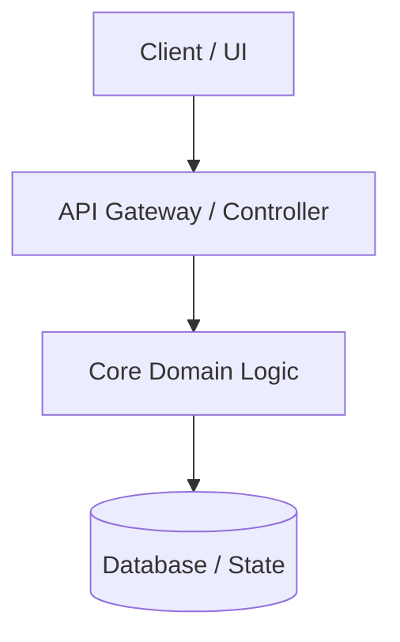

# Skill: Repository to Portfolio Case Study Generator

## Objective
Transform a raw code repository into a compelling, narrative-driven `CASE_STUDY.md` file. Unlike a standard `README.md` (which explains *how to install and use* the code), a portfolio case study explains **why the project exists, what hard problems were solved, the architectural trade-offs made, and the tangible impact of the solution.**

---

## Execution Workflow

When invoked, execute the following four phases sequentially. Do not skip directly to writing before gathering evidence from the codebase.

### Phase 1: Repository Reconnaissance (The "What")
Scan the high-level indicators of the repository to establish baseline context without reading every line of source code.

1. **Documentation & Metadata:**
   - Read `README.md`, `CONTRIBUTING.md`, `CHANGELOG.md`, and any `/docs` or `/adr` (Architecture Decision Records) directories.
2. **Manifest & Tech Stack:**
   - Inspect dependency files (`package.json`, `pyproject.toml`, `requirements.txt`, `Cargo.toml`, `go.mod`, `pom.xml`, `Gemfile`, etc.).
   - Categorize dependencies into: Core Framework, State/Data Management, UI/Styling, Testing, and Build/Tooling.
3. **Infrastructure & DevOps:**
   - Check `Dockerfile`, `docker-compose.yml`, `.github/workflows/`, `vercel.json`, `netlify.toml`, or IaC files (Terraform, Pulumi) to understand deployment and CI/CD pipelines.
4. **Directory Topology:**
   - List the top 2–3 levels of the file tree to identify the architectural pattern (e.g., Feature-sliced design, Clean Architecture, MVC, Monorepo/Turborepo, Microservices).

### Phase 2: Forensic Code Analysis (The "How & Why")
A weak case study merely lists libraries ("Built with React and Tailwind"). A strong case study highlights engineering rigor. Search the codebase for the following signals:

1. **Complex Business Logic & Algorithms:**
   - Locate the largest or most heavily imported core modules (e.g., custom engines, parsers, schedulers, state machines, middleware, custom hooks).
   - Look for algorithmic optimizations, such as reducing lookup complexity from $\mathcal{O}(n^2)$ to $\mathcal{O}(n)$ or $\mathcal{O}(1)$ via indexing, memoization, or caching.
2. **Data Flow & Persistence:**
   - Examine database schemas (`schema.prisma`, SQL migrations, Mongoose models, Drizzle schemas) and API layers (GraphQL resolvers, tRPC routers, REST controllers).
   - Identify how data integrity, validation (e.g., Zod, Pydantic), and security (auth, rate-limiting, RBAC) are enforced.
3. **Performance & Resilience:**
   - Search for concurrency handling, worker threads, queue systems, optimistic UI updates, lazy loading, streaming, or error boundaries.
4. **Git History Archeology (If `.git` is available):**
   - Run `git log -n 30 --oneline` or search commit messages for keywords like `fix`, `perf`, `refactor`, `migrate`, or `optimize`.
   - Identify at least 1–2 major pivots or tough bugs that were conquered during development.

### Phase 3: Audience & Angle Calibration
Before drafting, determine the target perspective (either infer from user prompt or ask briefly if ambiguous):
- **Mode A: Engineering Portfolio (Default)** — Aimed at hiring managers, senior engineers, and tech leads. Emphasizes system design, trade-offs, code quality, scalability, and deep technical problem-solving.
- **Mode B: Agency / Product Landing Page** — Aimed at clients, founders, and stakeholders. Emphasizes user experience, business value, speed to market, reliability, and ROI.

### Phase 4: Drafting `CASE_STUDY.md`
Generate the final markdown file (default filename: `CASE_STUDY.md` unless specified otherwise) adhering strictly to the template structure below.

---

## Output Template (`CASE_STUDY.md`)

Use the following structure to generate the case study. Adapt sections dynamically based on whether the project is a frontend app, backend API, CLI tool, library, or full-stack platform.

~~~markdown
---
title: "[Project Name] — [Compelling 1-Line Value Proposition]"
subtitle: "[Brief description of what the software is, e.g., A real-time collaborative markdown engine]"
role: "[e.g., Lead Full-Stack Engineer / Creator]"
timeline: "[Inferred from git history or placeholder, e.g., 3 Months]"
stack: ["[Tech 1]", "[Tech 2]", "[Tech 3]", "[Tech 4]"]
live_url: "[URL if found in repo, else placeholder]"
repo_url: "[Repo URL if found, else placeholder]"
---

# [Project Name]: [Action-Oriented Headline]

> **TL;DR:** [2–3 sentences summarizing the problem, the solution built, and the standout technical achievement or metric.]

---

## 1. The Problem & Context
*Describe the pain point or gap in the market this project addresses. Why did existing solutions fall short? Who is the target user?*

- **The Core Challenge:** [Detail the primary friction point]
- **The Goal:** [What success looked like before writing the first line of code]

---

## 2. System Architecture & Tech Stack
*Provide a high-level overview of how the system is structured and why specific technologies were chosen over alternatives.*

### Architecture Diagram
*(Generate an accurate Mermaid.js diagram representing the actual data flow, module interaction, or infrastructure found in the repo)*

### Key Technology Choices & Trade-offs
| Layer | Technology | Why It Was Chosen (The Trade-off) |
| :--- | :--- | :--- |
| **[e.g., Frontend]** | [Tech] | [Explain why this fit the project better than alternatives based on repo usage] |
| **[e.g., Backend/Core]** | [Tech] | [Justification] |
| **[e.g., Data/State]** | [Tech] | [Justification] |
| **[e.g., Infra/Tooling]** | [Tech] | [Justification] |

---

## 3. Technical Deep Dives (Challenges & Solutions)
*This is the centerpiece of the case study. Highlight 2–3 concrete engineering problems discovered in the codebase and explain how they were solved.*

### Challenge 1: [Specific Technical Problem, e.g., Real-Time State Synchronization]
- **The Bottleneck:** [Explain what made this hard—e.g., race conditions, large payloads, complex parsing]
- **The Solution:** [Explain the exact pattern, algorithm, or architecture implemented in the code. Reference specific modules/files if helpful.]
- **Code/Pattern Spotlight:**
  *(Include a concise, representative snippet or pseudocode from the repo that demonstrates clean architecture or clever logic)*

### Challenge 2: [Second Technical Problem, e.g., Type-Safe Pipeline / Performance Optimization]
- **The Bottleneck:** [Problem context]
- **The Solution:** [Implementation details]

---

## 4. Notable Features & UX Polish
*Translate technical implementation into user-facing value.*
- **[Feature 1]:** [How it works under the hood + why users love it]
- **[Feature 2]:** [How it works under the hood + why users love it]
- **[Feature 3]:** [How it works under the hood + why users love it]

---

## 5. Impact, Metrics & Takeaways
*Quantify the results using codebase evidence (e.g., test coverage, bundle size, algorithmic speedups) or provide bracketed placeholders for business metrics the author can fill in.*

- **Performance / Scale:** [e.g., Sub-$50\text{ms}$ response times via edge caching / Zero runtime dependencies]
- **Reliability:** [e.g., End-to-end type safety and X% automated test coverage across critical paths]
- **Business/User Impact:** *[Placeholder: Insert user adoption, conversion lift, or time saved]*

### What I Would Do Differently / Future Roadmap
*Demonstrate senior-level self-awareness by noting current limitations or next steps.*
- [Future improvement 1 based on `TODO` comments, open issues, or architectural scaling limits]
- [Future improvement 2]
~~~

---

## Style & Quality Guidelines

1. **Ban Generic AI Fluff:**
   - Never use empty buzzwords like *"cutting-edge," "seamless," "robust," "revolutionary,"* or *"leveraged modern technologies"* without backing them up with concrete proof from the codebase.
   - Instead of saying *"Built a fast backend,"* say *"Implemented an in-memory LRU cache layer in `src/cache/lru.ts` to bypass redundant database queries for hot keys."*

2. **Emphasize Trade-offs Over Hype:**
   - Senior engineers and clients trust builders who understand trade-offs. Explain *why* a simpler or more complex approach was taken (e.g., *"Chose SQLite over PostgreSQL to eliminate network latency and simplify single-binary deployment"*).

3. **Include Visual Hooks:**
   - Always generate a valid **Mermaid.js** diagram (`flowchart`, `sequenceDiagram`, or `erDiagram`) that accurately reflects the codebase's actual modules.
   - Insert clear `[IMAGE PLACEHOLDER: Description of ideal screenshot or GIF to capture]` markers in the document so the user knows exactly what visual assets to record for their landing page.

4. **Never Hallucinate Metrics:**
   - If you can measure something directly from the repo (e.g., number of tests, bundle configuration, algorithmic complexity), state it accurately.
   - If a metric requires production analytics (e.g., Monthly Active Users, revenue increase, p99 latency in prod), insert an explicit callout: `[TODO: Add production metric here, e.g., Reduced load time by X%]`.